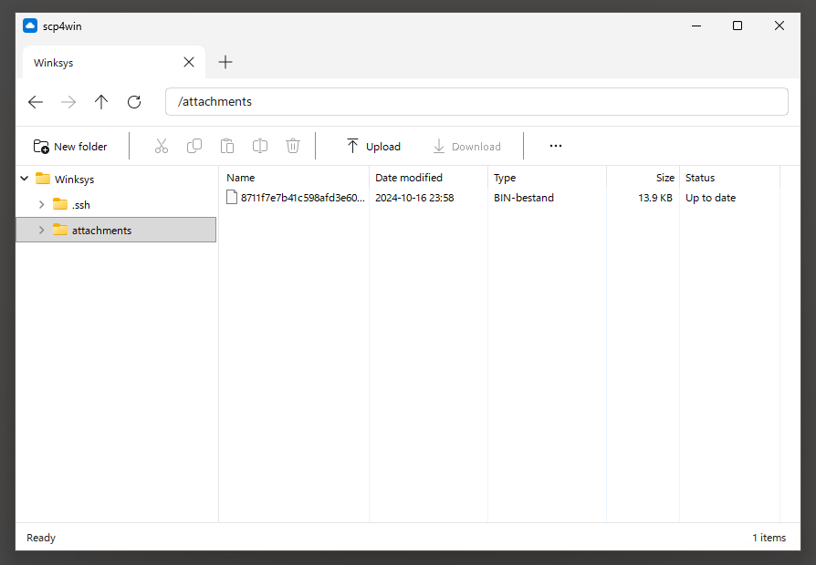

# scp4win

The ultimate simple cloud storage client. As simple as it gets.

Your cloud is any server you can SSH into. No sync engine, no daemon, no
database, no vendor. Just a Windows window on a folder on your server.



- **Browse** the server like Windows Explorer: rename, move, copy and delete
  happen directly on the server.
- **Look at a file:** double-click it to open a read-only copy with its
  default application.
- **Work on a file:** drag it out, edit it, drag it back.
- **Never lose work:** if someone changed the file in the meantime, or you
  upload a different file with the same name, scp4win asks before it
  overwrites. No locks, no conflicts hidden from you.
- **Nothing to install on the server:** plain OpenSSH (SFTP) is all it needs,
  and it keeps nothing there but your files.
- **Feels like home:** a Windows 11 style window with tabs for several
  connections, light or dark like the rest of Windows.

## Get started

You need to be on Windows 11. Install the MSI from the
[releases](https://github.com/mevdschee/scp4win/releases). It installs for
your user only and does not need admin rights. Run scp4win from
the Start menu, enter your server, username and remote folder, and you have a
cloud. Log in with your SSH agent, Pageant, a key file or a password. Use "Check
for updates" in the "..." menu to get new versions.

To use it without installing, download `scp4win-<version>-amd64.exe` instead
and run it from anywhere. It is the same program the installer installs. The
settings still go to `%APPDATA%\scp4win`, and "Check for updates" opens the
download page instead of installing. For Windows on ARM there is
`scp4win-<version>-arm64.exe`, a native build that is only available as a
portable exe; the installer works there too, but runs the amd64 build
emulated.

Each release has a `SHA256SUMS` file. To check a download, compare its hash
with the one listed there, for example in PowerShell:

    Get-FileHash scp4win-<version>-amd64.exe

### Code signing

Since version 0.3.7 the installer and the exes are signed with a Certum code
signing certificate issued to Maussoft B.V. To check, right-click the file in
Explorer, choose Properties and open the "Digital Signatures" tab. SmartScreen
may still warn about a new release until enough people have downloaded it
("More info", "Run anyway"). Do not run a file that is not signed by Maussoft
B.V. The source and the build script are in this repository, so you can also
build the exe yourself.

## Build

```
go install github.com/tc-hib/go-winres@latest
go test ./...            # runs on Linux, except for dragging files out
./run.sh                 # build scp4win.exe and run it with Wine
./release.sh [minor]     # build the MSI and the portable exes, publish a GitHub release
```

`release.sh` signs the exes and the MSI with
[ssctl](https://github.com/mevdschee/simplysign-go) and the Certum certificate
in SimplySign; run `ssctl login` first and log in with a token from the
SimplySign mobile app. SimplySign Desktop is not needed.

## Why? Other tools

There are great open source tools for files on a SFTP server. scp4win exists
because none of them is as simple and easy to use and learn.

- **File transfer clients:** [WinSCP](https://winscp.net),
  [FileZilla](https://filezilla-project.org) and
  [Cyberduck](https://cyberduck.io): powerful clients with many protocols,
  two-pane views, sync and scripting.
- **Drive mounts:** [SSHFS-Win](https://github.com/winfsp/sshfs-win) and
  [rclone mount](https://rclone.org/commands/rclone_mount/) make the server look
  like a local drive that every application can use directly.
- **Sync tools:** [rclone](https://rclone.org) and
  [Syncthing](https://syncthing.net) keep copies in sync on several machines.
- **Self-hosted cloud suites:** [Nextcloud](https://nextcloud.com) and
  [Seafile](https://www.seafile.com) give you a complete cloud with their own
  server software.
- **SSH clients with a file browser:**
  [electerm](https://github.com/electerm/electerm) and
  [Muon SSH](https://github.com/devlinx9/muon-ssh) combine a terminal with SFTP.

Any of these projects has more features and a more complicated user interface.

## To do

scp4win works, but has seen little testing outside of the happy path. Things
that still need to be tested properly:

- **Many files:** folders with thousands of files and deep folder trees, both
  for browsing and for copying, moving and deleting.
- **Large files:** uploads and downloads of several gigabytes, progress
  reporting, cancelling halfway and running out of disk space on either side.
- **Failure modes:** the connection dropping during a transfer, the server
  restarting, permission denied, files locked or open in another application,
  changed host keys, wrong or expired credentials and slow connections.
- **Display scaling:** different DPI settings (100%, 125%, 150%, 200%) and
  moving the window between monitors with different scaling.
- **Translations:** currently available in English only, needs other languages
  as well, such as Dutch, Spanish and French.
- **SSH servers:** only tested against OpenSSH on Debian 13. Other OpenSSH
  versions, other distributions, macOS, Windows OpenSSH, Dropbear and SFTP-only
  hosting (chrooted accounts, NAS devices) still need testing.

## License

MIT. Icons from
[Fluent UI System Icons](https://github.com/microsoft/fluentui-system-icons)
(MIT).
